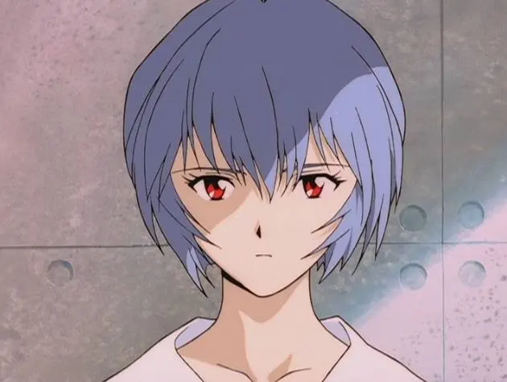
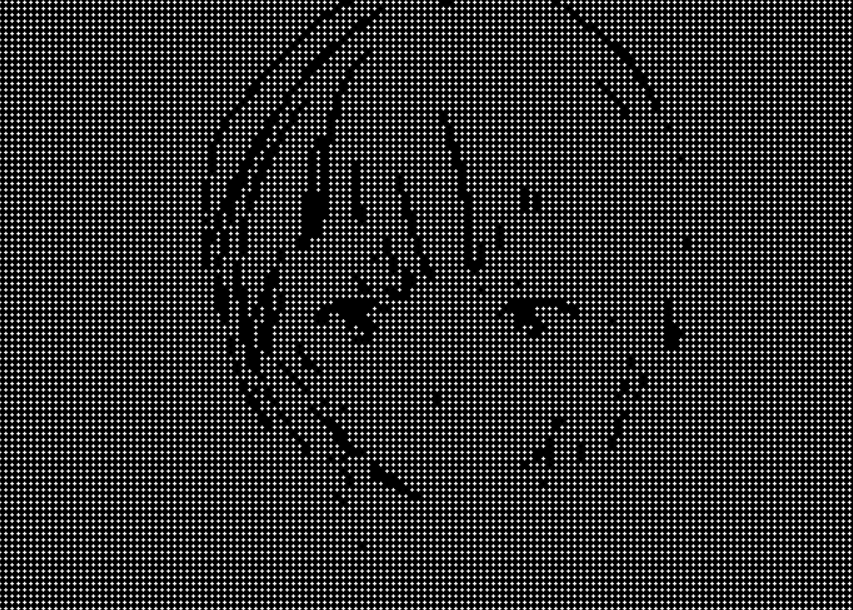

# ◉ Dot Art Maker

> Turn your photos into tiny little dots.  
> **Black. White. Turtle. That's it.**

A small retro-style Python project that transforms images into **dot art** using Python Turtle. Choose your dot size and spacing, then watch your image come to life as white dots on a black background.

## 🖼️ Before → After

| Before | After |
| --- | --- |
|  |  |

## ✨ Features

- **Image to dot art:** Converts an image into grayscale and draws it with white dots on a black background.
- **Simple GUI:** Select your image and settings from the main window.
- **Optional saving:** Save the finished artwork as a PNG, JPEG, or BMP image.

## 🛠️ How It Works

1. Select an image from your computer.
2. The image is converted to grayscale.
3. The app processes the image pixel by pixel.
4. Dark areas are skipped, while brighter areas are drawn as white dots.
5. Turtle draws the result on a black canvas using your selected dot size and spacing.

For the best results, use a **black-and-white or high-contrast image**.

## 🚀 Run

Make sure Python and Pillow are installed, then run:

```bash
python dot_art_maker_gui.py
```

Select an image, choose your preferred dot size and spacing, and the drawing process will start automatically.

## 🎛️ Options

| Setting | Choices | What it changes |
| --- | --- | --- |
| Dot Size | Small, Medium, Large | Controls how big each dot appears. |
| Dot Spacing | Near, Far | Controls how close together the dots are. |
| Save Result | On / Off | Optionally saves the artwork when drawing finishes. |

## 📦 Requirements

- Python
- Pillow

Turtle and Tkinter are included with most standard Python installations.

## 🎨 About

**Made with Python + Pillow + Turtle.**

A tiny creative coding project with a minimal black-and-white look.
